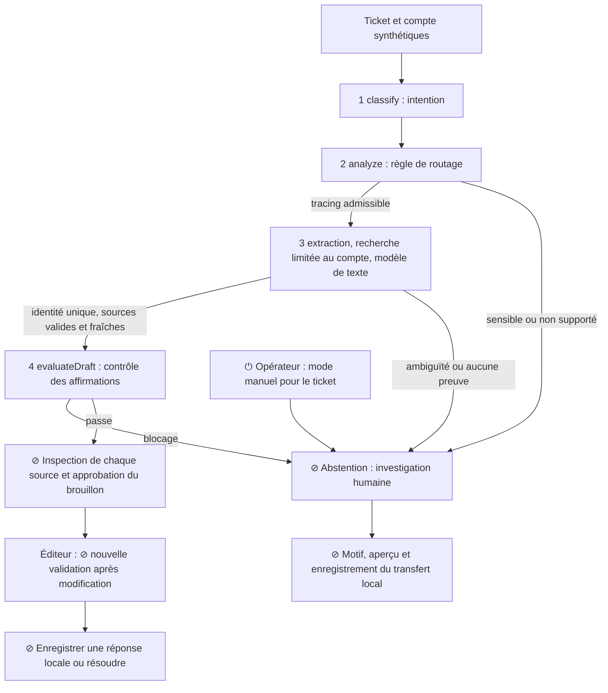

# 04 · Architecture — FlowAssist · Session 4

9 novembre 2026 · Architecture du code présent dans `prototype/`, pas de l’intégration cible. Remise du devoir : 15 novembre (les modèles indiquent encore le 6).

## 1. One-line description
FlowAssist aide un spécialiste support à tracer un paiement synthétique et préparer une réponse EN/FR/DE citant deux sources, avec vérification et décision humaines avant tout enregistrement local.

## 2. The diagram

Il n’existe aucun envoi client, mouvement de fonds ou transfert réel. Les fonctions `sourceRecords`, `makeDraft`, `evaluateDraft` et `handover` sont dans `prototype/engine.js`; les points humains et le mode manuel sont dans `prototype/app.js`.

## 3. Component table
| # | Component | Rung | Pattern | Trust level | Checkpoint ⊘ | Metric observed |
|---|---|---|---|---|---|---|
| 1 | `classify` | 1 règles, pas de ML | routing | L1 suggestion | abstention sur intention sensible | État de sortie ; pas de mesure indépendante du routeur |
| 2 | `analyze` : langue, compte, portée, référence, fraîcheur | 1 règles | routing / chaining | L3 lecture locale synthétique | abstention | 50/50 états attendus après correction, jeu de développement |
| 3 | Extraction, `sourceRecords`, `makeDraft` | 1 règles et gabarits, pas de modèle préentraîné | chaining | L2 brouillon | inspection et approbation | 15/50 brouillons ; 0 source étrangère observée |
| 4 | `evaluateDraft` et validation de l’éditeur | 1 règles | chaining | L2 avec décision humaine | approbation, puis nouvelle approbation après édition | 0 brouillon sur les cas étiquetés human-only ; rédaction libre non certifiée |

L1–L4 décrivent ici les niveaux d’autonomie du projet, pas une certification de sécurité. Le starter pédagogique propose des rungs 2/1/3/1 ; notre implémentation est explicitement 1/1/1/1. Aucun modèle ne calcule de score ; F19 fournit un score synthétique d’entrée pour tester l’abstention.

## 4. Workflow or agent?
Un workflow : toutes les étapes et bifurcations sont écrites à l’avance. Aucun modèle ne choisit d’outil. C’est adapté au risque d’une mauvaise identité ou d’un statut financier inventé. Avant d’introduire un modèle, il faut une identité serveur, une recherche réellement autorisée, un schéma de sortie strict, un timeout et une évaluation indépendante ; la décision finale demeure humaine.

## 5. Fallbacks
- Retrieval vide : aucun brouillon ; demander une référence unique ou préparer un transfert.
- Confiance sous le seuil : le runtime ne calcule pas de score. Pour une correspondance marquée `matchMethod=model`, un score absent, non numérique, non fini, inférieur à 0,95 ou supérieur à 1 provoque une abstention. Les contrôles compte/référence/montant/sources restent obligatoires. F19 est corrigé.
- Policy block : texte critique inutilisable ; investigation ou transfert humain. Une rédaction libre exige une revue factuelle manuelle.
- API indisponible : aucune API appelée. L’intégration et ses timeouts ne sont pas testés ; le mode manuel local reste disponible. Échec du stockage navigateur : mémoire seulement.

## 6. The override switch ⏻
- Propriétaire opérationnel du bouton : spécialiste qui utilise l’onglet ; responsable d’un futur arrêt global : Ops, personne à nommer avant pilote.
- Action : passer le ticket en mode manuel ; insertion assistée désactivée. Reprise explicite avec inspection/approbation remises à zéro.
- Portée : un ticket dans un onglet. Aucun arrêt serveur global.
- Testé le 9 novembre 2026 par exécution automatisée `python3 scripts/verify_s3.py`, scénario « manual fallback and resume require a fresh inspection ». Ni test utilisateur ni vérification visuelle navigateur.

## 7. Data
- Démonstration : `prototype/data.js`, paiements/comptes entièrement fictifs publics ; aucun entraînement.
- Évaluation : `evals/eval_set_v0.csv`, 50 propositions de labels IA ; fixtures exécutables dans `evals/fixtures_v0.json`. Deux validations humaines restent à obtenir dans `label_review.csv`.
- F01–F20 étaient déjà exposés au développement ; F21–F50 ont été étiquetés avant le premier passage. Après analyse et correction, les 50 sont désormais du développement. Ils ne constituent plus un jeu tenu à l’écart et doivent être remplacés pour une mesure indépendante.
- Résultats avant/après : `evals/results_baseline_v0.json` et `evals/results_v0.json`, empreintes SHA-256 du moteur et des fixtures. Les données saisies restent dans sessionStorage de l’onglet. Voir [gouvernance](governance.md#session-4--contrôles-et-évaluation).

## 8. Eval result v0
**Acceptabilité par deux évaluateurs : non mesurée ; critère métier non démontré.** Le critère FlowAssist est ≥41,2 % de gain de temps actif sur 200 cas éligibles, QA ≥92 %, précision de détection ≥98 % et aucune exposition critique. Ce n’est pas le seuil Paylio de 45 %. Sur le jeu de développement : 50/50 états concordants, 15/50 brouillons automatiques ; aucun jugement humain de qualité. Voir [rapport](evals/report_v0.md).

## 9. What you would build next
Faire valider les labels et noter les sorties indépendamment par deux personnes.
Constituer un nouveau jeu tenu à l’écart, puis instrumenter l’essai de temps apparié sur 200 cas.
Ajouter les connecteurs et l’autorisation serveur ; le score reste une entrée contrôlée, jamais une autorisation.
