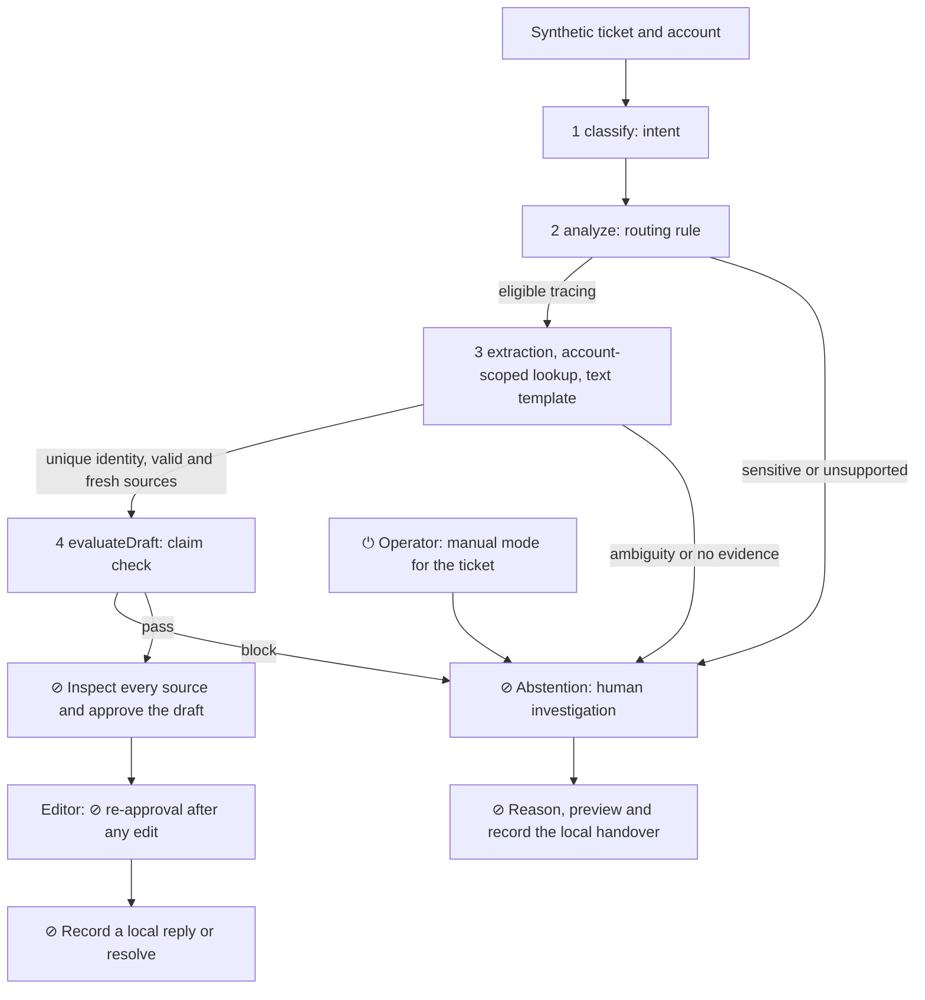

# 04 · Architecture — FlowAssist · Session 4

9 November 2026 · Architecture of the code that exists in `prototype/`, not of the target integration. Assignment due 15 November (the S4 templates still say 6 November).

## 1. One-line description
FlowAssist helps a support specialist trace a synthetic payment and prepare an EN/FR/DE reply citing two sources, with human checking and decision before anything is recorded locally.

## 2. The diagram

There is no customer sending, fund movement or real handover. `sourceRecords`, `makeDraft`, `evaluateDraft` and `handover` live in `prototype/engine.js`; the human checkpoints and manual mode live in `prototype/app.js`.

## 3. Component table
| # | Component | Rung | Pattern | Trust level | Checkpoint ⊘ | Metric observed |
|---|---|---|---|---|---|---|
| 1 | `classify` | 1 rules, no ML | routing | L1 suggestion | abstention on sensitive intent | Output state; no independent router measurement |
| 2 | `analyze`: language, account, scope, reference, freshness | 1 rules | routing / chaining | L3 local synthetic read | abstention | 50/50 expected states after the fix, development set |
| 3 | Extraction, `sourceRecords`, `makeDraft` | 1 rules and templates, no pretrained model | chaining | L2 draft | inspection and approval | 15/50 drafts; 0 foreign sources observed |
| 4 | `evaluateDraft` and editor validation | 1 rules | chaining | L2 with human decision | approval, then re-approval after edit | 0 drafts on cases labelled human-only; free-text rewording not certified |

L1–L4 are the project's autonomy levels, not a safety certification. The teaching starter uses rungs 2/1/3/1; our implementation is explicitly 1/1/1/1. No model computes a score; F19 supplies a synthetic input score to test abstention.

## 4. Workflow or agent?
A workflow: every step and branch is written in advance, and no model chooses a tool. This fits the risk of a wrong identity or an invented financial status. Before introducing a model we need server-side identity, genuinely authorized retrieval, a strict output schema, a timeout and an independent evaluation; the final decision stays human.

## 5. Fallbacks
- Nothing found: no draft; ask for a unique reference or prepare a handover.
- Low confidence: the runtime computes no score. For a match marked `matchMethod=model`, a score that is missing, non-numeric, non-finite, below 0.95 or above 1 forces abstention. Account/reference/amount/source checks remain mandatory. F19 is fixed.
- Policy block: critical text cannot be used; human investigation or handover. Free rewording requires a manual factual review.
- API down: no API is called. Integration and its timeouts are untested; local manual mode stays available. Browser storage failure: in-memory only.

## 6. The override switch ⏻
- Operational owner of the button: the specialist using the tab. Owner of a future global stop: Ops, a named person to be appointed before any pilot.
- Action: switch the ticket to manual mode; assisted insertion is disabled. Resuming is explicit and resets inspection/approval.
- Scope: one ticket in one tab. No global server stop.
- Tested on 9 November 2026 by the automated run `python3 scripts/verify_s3.py`, scenario "manual fallback and resume require a fresh inspection". Not a user test or a visual browser check.

## 7. Data
- Demo: `prototype/data.js`, entirely fictional public payments/accounts; no training.
- Evaluation: `evals/eval_set_v0.csv`, 50 AI-proposed labels; executable fixtures in `evals/fixtures_v0.json`. Two human approvals are still required in `label_review.csv`.
- F01–F20 were already exposed during development; F21–F50 were labelled before the first run. After analysis and fixes, all 50 are now development cases. They are no longer a held-out set and must be replaced for an independent measurement.
- Before/after results: `evals/results_baseline_v0.json` and `evals/results_v0.json`, with SHA-256 hashes of the engine and fixtures. Data entered in the app stays in the tab's sessionStorage. See [governance](governance.md#session-4--checkpoints-and-evaluation).

## 8. Eval result v0
**Acceptability by two graders: not measured; business criterion not demonstrated.** The FlowAssist criterion is ≥41.2% active-time saving on 200 eligible cases, QA ≥92%, detection precision ≥98% and zero critical exposures. It is not Paylio's 45% threshold. On the development set: 50/50 matching states, 15/50 automatic drafts; no human quality judgement. See the [report](evals/report_v0.md).

## 9. What you would build next
Have the labels validated and the outputs graded independently by two people.
Build a new held-out set, then instrument the paired timing trial on 200 cases.
Add connectors and server-side authorization; the score stays a checked input, never an authorization.
