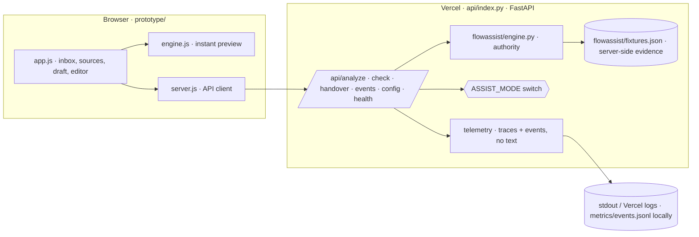

# FlowAssist specification · v3 · whole project (S1–S7)

**Updated 17 November 2026.** One document that traces the product from diagnosis to operation and that a developer can build from. Each section names the course session it comes from and the file that holds the detail. **Shipped** means it exists in this repository and is tested; **target** means the production design, not yet built.

| Session | Decision it fixes here | Detail |
|---|---|---|
| S1 Diagnosis | problem, user, do-nothing, trust levels, governance questions | `01_problem_statement.md`, `governance.md` S1 |
| S2 Sizing | business case, flip point 41.2 %, hurdle, build/buy | `02_sizing.xlsx`, `02_investment_memo.md` |
| S3 MVP design | process redesign, MoSCoW, model ladder, data audit, criterion, user research | `03_product_brief.md`, `03_user_research.md` |
| S4 Build & decode | architecture, guardrails, eval-set, misses → spec lines | §3–§6, `04_architecture.md`, `evals/report_v0.md` |
| S5 Metrics | metric stack, attack set, LLM judge | §8, `evals/judge/`, `docs/TRACKING_PLAN.md` |
| S6–S7 Experiments & operation | switch, monitoring, incidents, rollback, owners, CI/CD | §7, §9, `docs/SETUP_CI.md`, `governance.md` S7 |

---

## 1. Problem and product (S1–S2)

**Problem.** Tier-1 payment-operations specialists at PayFlow B2B (scenario: 800 merchants, 12,000 tickets a month, 18 specialists) spend about 40 % of an 18-minute handling time searching ledgers and clearing logs before they can answer "where is my money?". All figures are course scenario assumptions, not company measurements.

**Job, one sentence.** When a merchant asks where a payment is, FlowAssist finds the matching transaction in that merchant's own records and prepares a cited EN/FR/DE status reply for the specialist to check, edit and approve.

**Never.** Send anything to a merchant on its own; move, refund or release money; write to a ledger; show a payment outside the assigned merchant; turn "sent to bank" into "received".

**Do-nothing.** Manual tools and macros, about 4 % efficiency gain a year (€57,600 in the base case).

**Business case.** Conditional GO. Base net value is €141,340 against a €125,000 next-best project (merchant self-serve portal), so the base case clears the hurdle. The flip point is a **41.2 % active-time saving** on eligible tracing tickets. Sensitivity to watch: at the sheet's own implied cost per ticket (€6.875 instead of €10) the base case drops below the hurdle (`02_investment_memo.md`).

**Build / buy / orchestrate.** Orchestrate: our rules and data, with a rented model only where it is earned.

## 2. Scope (S3)

| MUST (≤ 4) | SHOULD / COULD | WON'T (≥ 5, dated 3 Nov 2026) |
|---|---|---|
| merchant/policy gate with handover · cited tracing draft · paired timing and grading | source-preview polish · feedback shortcut | CRM tag automation · autonomous replies · dispute deadlines · KYC/AML explanations · refunds/settlement execution |

Also out: live bank or Zendesk connectors, fine-tuning, unsupported-language drafting, a customer-facing chatbot.

## 3. Architecture (S4) — shipped v0.6



**Principle.** The browser engine gives an instant preview. **The server decides every recorded action**: inserting a draft, recording a reply, recording a handover. The server reads evidence only from its own fixtures, so a client cannot inject transactions. Both engines must stay identical (`tests/test_parity.py`: 123 cases, 468 draft checks).

| # | Step | Code | Rung | Pattern | Trust level | Human checkpoint ⊘ |
|---|---|---|---|---|---|---|
| 1 | Router: intent | `classify` (`ROUTES`) | 1 rules (EN/FR/DE/ES) | routing | L1 suggestion | abstention: money, legal, dispute, compliance → person |
| 2 | Routing rule: scope and match | `analyze` | 1 rules | chaining with gates | L3 on the assigned merchant | abstention when ambiguous, stale or inconsistent |
| 3 | Drafter | `source_records`, `make_draft` | 1 templates | chaining | L2 draft | inspect every source, then approve |
| 4 | Policy checker | `evaluate_draft` | 1 rules | evaluator gate | L2 + server refusal | re-approval after any edit; final human review |
| — | Judge (offline) | `scripts/eval/judge.py` | 3 pretrained model (OpenAI `gpt-6-luna`) | evaluator | none in the product | humans validate the judge |

**Workflow, not agent.** Every path is drawn in advance and no model chooses a tool. That fits a domain where a wrong match is worse than no draft.

**Why rung 1 everywhere.** Rules pass the development set (50/50 states, 0 drafts on human-only tickets, 30/30 attacks). We climb to a rung-2 router or a rung-3 drafter only when a rung-1 part fails the criterion on real labelled tickets, which do not exist in coursework.

## 4. Contracts (shipped API)

| Endpoint | Request | Response |
|---|---|---|
| `GET /api/health` | — | `{status, engine_version}` |
| `GET /api/config` | — | `{assist_mode, assist_mode_source, engine_version, env}` |
| `POST /api/analyze` | `{ticket, reference?}` | `{state, gate, reason, queue, intent, checks, transaction, sources[], draft, assist_mode}`; `draft = null` when the switch is `off` |
| `POST /api/check` | `{ticket, reference?, text ≤ 4000, action: insert\|reply}` | 200 `{allowed, passed, manual_review, codes, issues}` · **422** on a critical issue · **409** when insertion is disabled by the switch |
| `POST /api/handover` | `{ticket, reference?, reason, note}` | `{allowed, packet}` (note redacted) · 422 without a reason |
| `POST /api/events` | `{event, properties}` | 202, or 422 for an unknown event (see §8) |

```typescript
type Ticket = { id: string; merchant: string /* assigned session scope, never parsed from text */;
  language: 'EN'|'FR'|'DE'|string; message: string /* ≤ 3000 */; receivedAt: string /* ISO-8601 */; sensitiveInput?: boolean };
type State = 'draft_ready' | 'context_only' | 'human_only';
type CheckCode = 'no_transaction'|'empty'|'sensitive'|'promise'|'commitment'|'amount'|'reference'|'citation'|'status_upgrade'|'manual_review';
```
Requests reject unknown fields. Amounts are integer minor units, never floats. Statuses: `pending · sent_to_bank · credited · failed · returned`. **Target:** the merchant comes from the authenticated session and `receivedAt` is stamped by the server; in the demo the client sends both.

## 5. Guardrails (shipped)

| Layer | Rule | Outcome |
|---|---|---|
| Input | prompt injection ("ignore tenant", `system:`, admin override, reveal another merchant) | human only |
| Input | secrets, credentials, IBAN in the message | redacted; human only |
| Input | intent is money action, legal, dispute or compliance (EN/FR/DE/ES lists) | human only, specialist queue |
| Input | unsupported language or currency, negative or invalid amount | human only / context only |
| Scope | the merchant from the session; no evidence from another merchant | empty context |
| Scope | unique reference; an amount alone never matches; amount and currency must agree | context only |
| Scope | snapshot ≤ 5 min old; ledger and clearing agree; source schema valid; gross − fee = net | context only |
| Scope | a model-derived match needs a score in [0.95, 1] **and** all checks above | context only |
| Output | money, arrival or legal commitments in EN/FR/DE ("we will credit back", "nous vous rembourserons", "wir erstatten", "entitled to compensation", "will arrive Monday") | **critical: refused** |
| Output | an amount or reference not in the sources; missing or foreign citations; "sent to bank" upgraded to "credited" | **critical: refused** |
| Output | any other free-text edit | allowed with a mandatory manual factual review |

Attack set: `evals/adversarial_v0.csv` (30 OWASP-style rows: LLM01, LLM02, LLM06, LLM09, legal) must stay at **0 misses**. One miss fails CI.

## 6. Interface and state machine (S3–S4, shipped)

- **Ticket states.** `draft_ready | context_only | human_only`. A ticket's lifecycle is `open → waiting | escalated | resolved`, and reopening resets inspection and approval.
- **Using a draft** requires `draft_ready`, every source inspected, the review box ticked, the switch `on`, the API reachable **and** a server `check(insert)` that passes.
- **Recording a reply** requires the final human review and a server `check(reply)` that is not critical. Any edit invalidates approval.
- **Handover** requires a reason, a refreshed preview and a server `handover`. The packet contains only authorized sources.
- **User-driven changes** (`03_user_research.md`):

| ID | Change | Status |
|---|---|---|
| D08 | Plain-language status with an amber/green/red tone (no green "sent to bank") | shipped v0.5 (UI); draft wording unchanged |
| D09 | "Verified facts" checklist above the draft | shipped v0.5 |
| D10 | Each source says what it confirms; ledger first | shipped v0.5 |
| D06 | Next step and follow-up time in context-only and handover replies | specified, not built |
| D07 | Documented typical processing time, labelled "typical, not guaranteed" | pending Ops/Legal |

- **Edge cases and fallbacks:**

| Condition | Required outcome |
|---|---|
| No match, or a missing reference | context only; ask the merchant; never invent a record |
| Two same-amount payments | context only; request a unique reference; Tier-2 if unresolved |
| Another merchant's reference, or a forged merchant in the text | nothing shown; human only |
| Currency differs, or FX unclear | context only; no conversion |
| Net and gross differ, and the source explains the fee | cite gross, fee and net; otherwise block |
| Stale or conflicting sources | context only, with timestamps |
| API down or timeout | page fails closed to manual handling ("Outage" class) |
| Opened from `file://` | local preview mode, labelled; server guardrails inactive |

## 7. Operation (S6–S7)

**Global switch ⏻.** The `ASSIST_MODE` environment variable, enforced by the server on every request:
- `on`: drafts can be inserted after the human checks.
- `suggest_only` (L1): drafts are visible but cannot be inserted.
- `off`: humans only, no drafts.
- Any other value fails safe to `suggest_only`.

On Vercel, change the variable and redeploy (about 1 minute). Who can press it: the Head of Payment Ops by day, the on-call engineer at night.

**Rollback plan (6 fields).**
- **Trigger:** any draft on a human-only ticket; a reply refused as critical that was still sent; a red production smoke test.
- **Who decides:** the Head of Payment Ops (day) or the on-call engineer (night).
- **Action:** `ASSIST_MODE=suggest_only`, then `off`; or revert the commit on `main`.
- **Time:** under 15 minutes.
- **What people see:** the banner states the mode, and agents continue manually.
- **Last tested:** to be filled at the first production test (`docs/SETUP_CI.md` §3).

**Incident classes.**

| Class | Signal | Action |
|---|---|---|
| Caught | `check_failed` (refused insertion or reply) | count it; add a spec line if it repeats |
| Sent wrong | a reopened ticket after a reply | apology, fix the knowledge base or rule, add a spec line |
| Harmful | a draft on a human-only ticket, or another merchant's data | roll back now, incident report, involve the DPO |
| Outage | `api_unavailable`, 5xx in the traces | the page fails closed to manual handling |

**Drift to watch.**
- Data drift: a new rail or reference format changes the share of tickets routed to a person.
- Concept drift: a policy change, so re-label the golden set.
- Knowledge drift: fixture age.
- Model drift: the judge model changes, so pin it and re-run the agreement.

## 8. Metrics and evaluation (S5)

| Level | What we measure | Source |
|---|---|---|
| 1 Model / rules | parity JS = Python; router decisions on probes | `make test-py` |
| 2 AI system | 50/50 expected states; 15 drafts; 0 on human-only | `make eval` |
| 3 Guardrails | 30/30 attacks; refusals by code; 0 foreign sources | `make adversarial`, events |
| 4 Product | funnel ticket → sources → draft used → reply; edit rate; handling time p50/p95 by language and plan | `make metrics` |
| 5 Business | active-time saving vs the 41.2 % flip point; QA ≥ 92 % | target: paired timing protocol (S6) |

- **Eval sets.**
  - `evals/eval_set_v0.csv`: 50 development cases, consumed by fixes, so used for regression only.
  - `evals/eval_set_v1.csv`: 200 held-out inputs, labelling in progress.
  - `evals/adversarial_v0.csv`: 30 attack rows.
- **Judge.** `evals/judge/rubric.md` (v1.1) was written before grading, and `judge_prompt.txt` is a copy of it. `scripts/eval/judge.py` (OpenAI `gpt-6-luna`; Claude optional) gives 11/15 human–judge agreement and catches 41/41 known-bad variants, with 0 over-accepted. The remaining 4 disagreements are a real defect: the reply language differs from the merchant's language (S5-M01). A second blind human grader is still required for human–human agreement.
- **Local metrics.** The page posts allowlisted events (`ticket_opened`, `source_inspected`, `draft_used`, `reply_recorded`, `handover_recorded`, `manual_mode_toggled`, `api_unavailable`) and the server adds `guardrail_blocked` and `check_failed`.
  - Unknown keys and long text are dropped, and no ticket text is stored.
  - `make dev` writes events and traces to `metrics/events.jsonl` (git-ignored).
  - `make metrics` writes `metrics/report.md`.
  - Event list and thresholds: `docs/TRACKING_PLAN.md`.

## 9. Delivery (shipped)

| Stage | Gate |
|---|---|
| Laptop | `make ci`: ruff, data sync, 145 Python tests, 41 Node tests, 50-case regression, attack set |
| Pull request | GitHub Actions `ci.yml` (same as `make ci`); branch protection requires it |
| `main` → production | `sync-deploy.yml` runs only after green CI, deploys that commit to the Vercel copy, then smoke-tests production until the new `engine_version` answers |
| Judge | manual workflow `judge.yml` or `make judge` (key in `.env`, never committed) |

**Hosting.** Static `dist/` and the Python function `api/index.py` share one Vercel project (rewrite `/api/* → /api/index`). Environment: `ASSIST_MODE`, `FLOWASSIST_ENV`. Setup guide: `docs/SETUP_CI.md`.

## 10. Decision log

| ID | Decision | Date |
|---|---|---|
| S4-M01 · M02 · M03 | references are never amounts; FAC/RE/REF accepted; a model score is an input checked in [0.95, 1], never authorization | 9 Nov |
| step-1-router | money, legal and cancellation intents go to a person; "bloqué" (stuck) stays tracing (F05) | 17 Nov |
| policy v2 | affirmative money, arrival and legal commitments are critical in EN/FR/DE | 17 Nov |
| v0.5 | D08–D10 in the interface; payment summary first | 17 Nov |
| v0.6 | server authority, global switch, attack set, judge, local metrics, CI/CD | 17 Nov |
| judge v1.1 | guideline fixed once after reading disagreements: 11/15 human–judge agreement, 41/41 known-bad escalated, 0 over-accepted | 17 Nov |
| S5-M01 (open) | the reply language must match the language the merchant wrote in (judge found EN messages answered in FR/DE: F22, F23, F25, F26) | 17 Nov |

## 11. Known limits and next steps
- All data is synthetic, and the 50 v0 cases are development data. The first real performance number must come from `eval_set_v1` (held out, labelled by people).
- No grader 2 yet, so there is no human–human agreement.
- S5-M01 is open: the reply language follows the ticket field, not the merchant's message.
- The business criterion (41.2 % saving) needs the paired timing protocol of `06_07_experiments_operations.md` (to write).
- **Target, not built:** authenticated merchant scope, server-stamped request time, live ledger/clearing connectors, D06–D07, a rung-2 router once labelled tickets exist.
